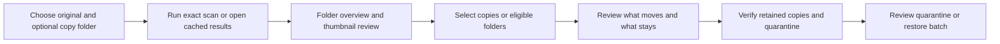

# PRD: Native Desktop Migration

**Author:** Codex, for the repository owner  
**Date:** 2026-10-22  
**Status:** Draft proposal; implementation has not started  
**Discovery:** Existing owner feedback, [requirements](../../../REQUIREMENTS.md), and [UX roadmap](../../../docs/ux-roadmap.md)

## Executive Summary

Build the macOS Apple Silicon desktop application described in `REQUIREMENTS.md`, using Tauri 2, React, TypeScript, and Rust. Deliver a fast exact-duplicate preview build early, then add verified quarantine and restore, and finally complete pixel and perceptual matching parity. Keep the working Python application available throughout testing.

## Problem and Users

The owner reviews a large personal photo collection and needs to compare folders without waiting for whole-library image analysis or repeatedly selecting small batches. Earlier folder cleanup also concealed that all images would leave a source folder. The current two-folder and thumbnail workflow is the behavior baseline; the native app must improve responsiveness while retaining its safety checks.

| User | Current difficulty | Desired outcome |
| --- | --- | --- |
| Owner testing on macOS | Slow scanning and repeated review steps | Open a comparison quickly and test against known copies |
| Future local desktop users | Unclear retained locations and cleanup consequences | See exactly what stays, what moves, and how to restore it |

## Goals and Success Metrics

These are proposed acceptance targets, not measured Rust results. Measure on the target Mac with a documented 30,000-image dataset; report internal SSD and external storage separately.

| Goal | Target | Measurement |
| --- | --- | --- |
| Fast reopening | Cached app launch to usable folder overview ≤2 seconds | Packaged release build; 20 launches |
| Responsive interaction | Selection and navigation p95 ≤200 ms, including during scans | Instrument 100 interactions |
| Quick cached comparison | Folder summary ≤500 ms; first visible cached thumbnails ≤1 second | 20 folder openings; separately report cold previews |
| Efficient unchanged scans | 0 full hashes or image decodes for unchanged, valid cached entries | Work counters; discovery/stat work still occurs |
| Analysis only when needed | 0 image decodes during exact discovery; unique-size files require 0 full hashes | Instrument generated candidate-filtering fixtures |
| Predictable cancellation | UI acknowledges cancel ≤200 ms; worker stops at safe boundaries | Large-file and slow-storage cases; incomplete work is labelled |
| Detection and safety | 100% agreed golden cases; 0 unintended moves or overwritten files | Rust parity, scope, journal, and fault-injection results |

Record cold scan time, bytes read, hashes performed, decode count, grouping time, and peak memory for at least 3 runs per dataset/storage combination. Compare Czkawka only with equivalent exact-match settings, cache state, roots, exclusions, and storage. Do not promise a cold-scan speedup before measurement.

## What We Are Building

### Applied Constraints

| Source | Scope/status | Effect on this proposal | Verification / unresolved choice |
| --- | --- | --- | --- |
| Owner's latest request | Explicit planning direction | Rust desktop app, improved UX, early testing, faster loading | This proposal awaits review |
| `REQUIREMENTS.md` §§4, 9, 15 | Existing architecture and migration specification | Tauri/React/TypeScript; independent Rust core; golden baseline first | Toolchain and dependency compatibility spike |
| Two-folder owner choice and `MEMORY.md` | Explicit behavior | Required protected original; optional duplicate scope; empty means rest of selected source | Scope and selection-reset parity tests |
| Nainital investigation and `folder_review.py` | Established safety behavior | Exact retained evidence; unique files stay; distinguish images from sidecars; separate zero-image acknowledgement | Live preflight and fault-injection tests |
| Project `AGENTS.md` and owner instructions | Existing repository constraints | Preserve Python/data; generated mutation fixtures; leave protected `AGENTS.md` unchanged | Isolated native data directory and fixture audits |
| Shared Git/database safety rules | Applicable workflow constraints | No existing-data migration during preview builds; schema execution and publication retain their approval requirements | Review proposed commands before applying them |
| `docs/ux-roadmap.md` | Proposed implementation direction | Staged analysis, bounded workers, persistent caches, visible-only previews | Benchmarks; evaluate Czkawka core before adoption |

### Requirements and Scope

| ID | Requirement | Priority / release |
| --- | --- | --- |
| R1 | Native folder pickers plus a searchable indexed-folder browser; original and duplicate paths visible together | Must: preview |
| R2 | Original and descendants protected; exclude overlapping duplicate roots; optional second root limits all results and actions | Must: preview |
| R3 | Exact mode starts with inventory and size filtering, then candidate prehash/full SHA-256; image analysis runs separately when requested | Must: preview |
| R4 | Background progress, cancellation, errors, persistent incremental index, and no whole-app rerender on selection | Must: preview |
| R5 | Folder overview ranked by duplicate data; virtualized thumbnails; large source/retained comparison; filename and path access | Must: preview |
| R6 | Select individual copies or reviewed folders; retain choices through ordinary navigation; reset on changed comparison scope | Must: cleanup alpha |
| R7 | Final review shows move count, retained locations, images staying, and any folder losing all images; revalidate selected and retained copies | Must: cleanup alpha |
| R8 | Journalled image/folder quarantine and collision-safe individual/batch restore; recovery after interruption | Must: cleanup alpha |
| R9 | Python-compatible normalized pixels, 64-bit pHash, threshold 6, connected-component grouping, and deterministic keeper suggestions | Must: complete photo MVP |
| R10 | Confirmed permanent deletion restricted to quarantine; packaged app works without developer runtimes | Must: complete photo MVP |
| R11 | Keyboard navigation, visible focus, accessible labels, dark/light appearance, and bounded loading/error states | Must: main workflows; polish throughout |
| R12 | Saved review queue and resumable cleanup across app restarts | Should: cleanup alpha / MVP |
| R13 | Rich comparisons such as zoom and metadata sorting | Could: after the main workflow is validated |

## User Experience

Use a stable desktop layout: folder navigation on the left, a virtualized contact sheet in the center, and a large comparison inspector on the right. A compact header contains **Original — protected** and **Find copies in — optional** path cards; a footer shows selected copies, bytes, retained originals, and the next action. Use native pickers rather than forcing long dropdown navigation.

With the second path empty, the left pane lists matching folders across the selected source. Selecting a folder scopes the contact sheet. With an explicit second path, open that comparison directly. Only duplicate-side cards are selectable; protected originals remain visibly marked. Distinguish exact, pixel-identical, and similar results with plain-language labels and evidence on demand.

## Triggers and Edge Cases

| Case | Required behavior |
| --- | --- |
| No second folder | Search the rest of explicitly selected source roots; never expand to home/disk |
| Original overlaps duplicate scope | Reject selection; backend independently enforces the same protection |
| Folder contains unique images or unindexed sidecars | Keep them; complete-folder eligibility requires a live full inventory |
| All images would move but `.DS_Store` remains | Show zero images staying; require the separate acknowledgement |
| Selected duplicate folder empties or disappears | Keep the scope visible; never silently search elsewhere |
| File, retained copy, or index changes | Invalidate affected evidence/confirmation and refresh before movement |
| Permission error, unplugged disk, corrupt image | Preserve files, report affected entries, and keep the rest of the UI usable |
| Interrupted action or occupied restore path | Reconcile from durable journal; never overwrite or repeat uncertain moves |

## Proposed Delivery Sequence

Milestones are acceptance gates, not calendar estimates. Detailed engineering tasks follow review of this proposal.

| Stage | Deliverable | Owner can test | Exit evidence |
| --- | --- | --- | --- |
| 1 — Baseline | Minimal Rust workspace, generated golden fixtures, Python reference exporter, dependency/toolchain spike, benchmark harness | Reference fixture report and exact CLI comparison | Exact hash, normalization primitives, Hamming distance, keeper ordering tests; documented parity command |
| 2 — Fast discovery | Versioned native index, candidate filtering, bounded workers, cancellation; evaluate `czkawka_core` versus a small dedicated exact engine | Cold/warm CLI scans with visible work counters | Equal exact results; cache invalidation and cancellation tests; reproducible SSD/external-storage timings |
| 3 — Desktop preview | Tauri shell and the comparison layout above; real exact results and cached previews; read-only actions | First desktop build: choose roots, scan, browse folders, compare thumbnails | Selection responsiveness, visible-only decoding, keyboard/component checks, packaged `.app` launch |
| 4 — Cleanup alpha | Rust operation journal, scope-bound preflight, checked-only and folder actions, quarantine, restore | Full review → quarantine → restore on disposable copies | Whole/partial folder tests, stale keepers, collisions, zero-image guard, interrupted-operation recovery |
| 5 — Photo parity | Full EXIF/RGBA pixel normalization and compatible perceptual analysis behind explicit modes | Pixel-identical and visually similar review | Golden outputs/distances/groups/keepers match; threshold boundary and format tests |
| 6 — Release testing | Packaging, deletion confirmation, accessibility/polish, license/security/build documentation | Standalone installer on a clean Mac account | Runtime independence, offline operation, release checks; signing/notarization status disclosed |

## Dependencies and Risks

The machine has Apple Silicon, Rust 1.89.0 active (1.95 also installed), Node 24.22.1, pnpm, and Apple Command Line Tools. Select and pin supported project toolchains after a minimal Tauri build; no global toolchain changes are part of this proposal. Crates, frontend dependencies, decoder support, and packaging have not yet been verified.

| Risk | Likelihood / impact | Mitigation |
| --- | --- | --- |
| Rust decoder/resizer/DCT differs from Pillow/ImageHash | High / High | Golden parity; versioned analyzer contracts; do not claim compatibility prematurely |
| Rust is still limited by external-drive I/O | High / Medium | Size/prehash filtering, adaptive bounded work, separate cold/warm benchmarks |
| Bulk cleanup or recovery moves unintended files | Medium / High | Scope-bound plans, fresh exact verification, durable journal, disposable fault tests |
| Czkawka core API/license or hashing semantics do not fit | Medium / Medium | Small integration spike; keep discovery replaceable; retain independent safe-file layer |
| macOS preview formats or packaged paths behave differently | Medium / Medium | Explicit supported-format matrix; native thumbnail/packaging spike before expansion |

## Rollout and Deferred Scope

Keep `app.py`, `folder_review.py`, the existing SQLite database, JSON history, and quarantine contents in place. Native builds use separate app-data storage and explicit selected roots. Importing legacy history/cache is a later reviewed migration; abandoning the preview app must leave Python usable.

Video similarity, audio, cloud sync, automatic deletion, and Windows packaging are deferred until photo parity and safe local cleanup are established. Do not build every proposed crate or navigation section before it has working behavior.

## Open Questions and Next Gate

No further owner information is needed to draft this scope. Engine reuse, format support, toolchain pins, and latency feasibility are engineering spike outcomes, not assumed approvals. Confirm the staged scope and targets before the technical design and canonical implementation task breakdown; execution mode is selected at implementation start.

**Current evidence:** repository inspection and installed-tool checks only. The existing Python suite last passed 64 tests; Rust, native UI, benchmark, and packaging results are pending. No implementation code or user data was changed for this proposal.
