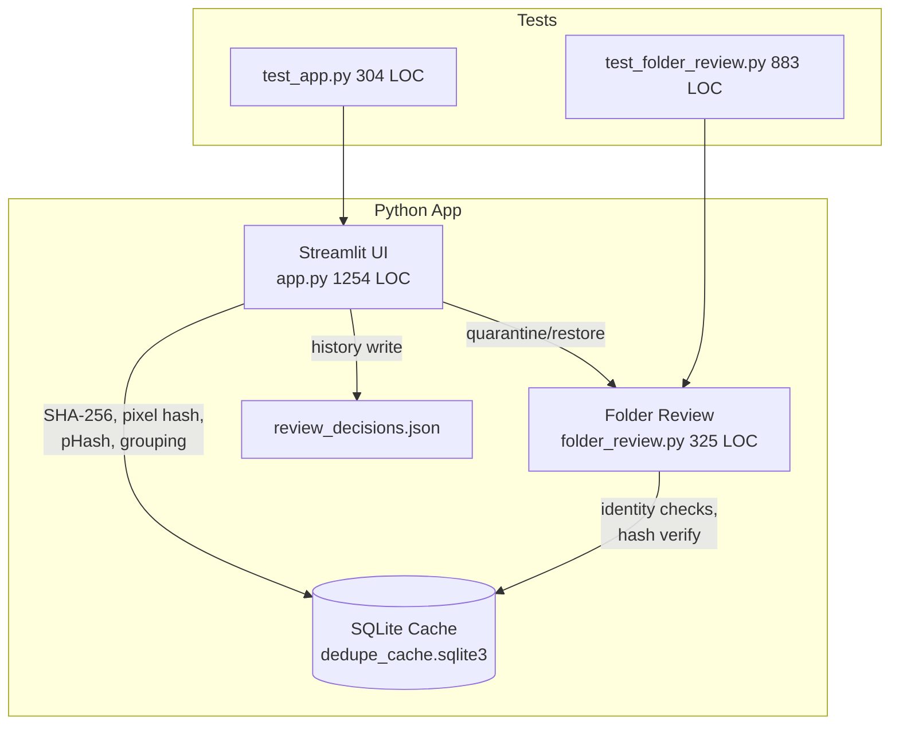
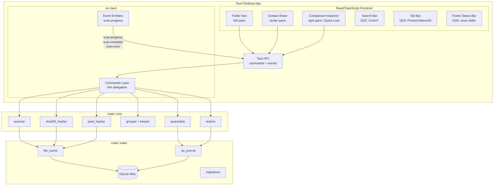
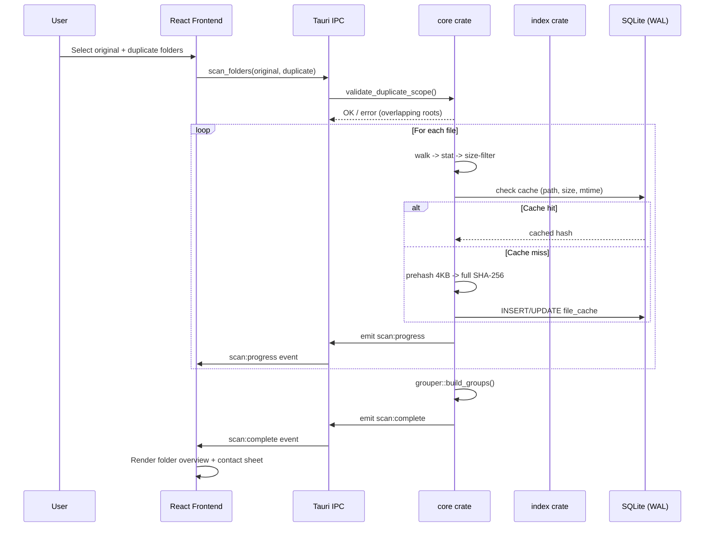
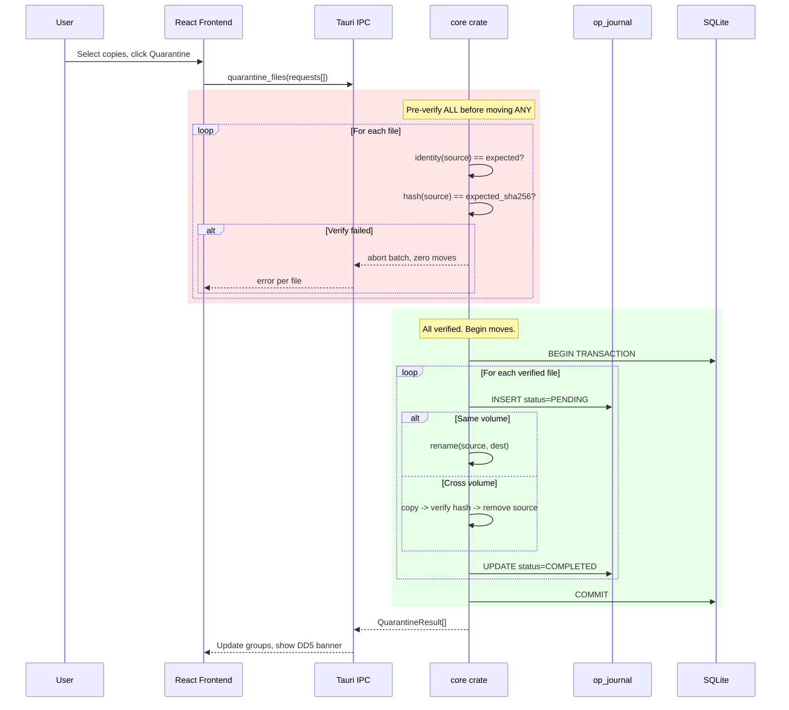

# TRD: Native Desktop Migration

**Author**: Claude, for the repository owner
**Date**: 2026-10-23
**Status**: Draft
**PRD**: [PRD.md](./PRD.md)
**Reviews**: [CEO + Design + Eng review](../../../docs/designs/native-desktop-ceo-review.md)

## Overview

Port the working Python/Streamlit photo deduplication app to a native macOS desktop application using Tauri 2, React/TypeScript, and Rust. The Rust backend handles scanning, hashing, grouping, quarantine, and SQLite indexing. The React frontend provides a three-pane layout with keyboard-driven review. pHash is deferred to post-MVP (D3); ship exact + pixel-identical first.

## Current Architecture



Key patterns in the existing code:
- `identity()` at `folder_review.py:19-24`: O_NOFOLLOW + pre/post stat checks (TOCTOU mitigation)
- `hash_regular_file()` at `folder_review.py:27-41`: open-check-read-check three-stage verify
- `validate_duplicate_scope()` at `folder_review.py:111-126`: non-overlapping root enforcement
- `signatures()` at `app.py:48-55`: EXIF transpose + RGBA convert + big-endian 8-byte dimension prefix
- Two-folder asymmetric model: protected original root vs optional duplicate root
- 64 passing tests across both test files

## Applied Constraints

| Source decision/rule | Scope/status | Effect on design/schema/naming | Verification or unresolved choice |
|---|---|---|---|
| D2-CRATES (CEO, approved) | Architecture | 2-3 Rust crates: core + index + Tauri app. Split when real boundaries emerge. | Workspace Cargo.toml with 2 crates initially |
| D3-STAGE5 (CEO, approved) | Scope | pHash deferred to post-MVP. No BK-tree, no perceptual grouping in MVP. | Exclude pHash from Stage 1-4 scope |
| D4-DND (CEO, approved) | UI | Drag-and-drop folder selection alongside native pickers | Tauri 2 onDrop event handling |
| D5-QUICKLOOK (CEO, approved) | UI | macOS Quick Look integration via spacebar | Spike needed (T10) before committing approach |
| D6-THUMBFMT (CEO, approved) | Performance | WebP thumbnail cache at quality 80 | image crate WebP encoder |
| D7-GIT (CEO, approved) | Workflow | Git init with .gitignore before implementation | Done: `feature/native-desktop` branch created |
| D8-PHASH-SPEC (CEO, approved) | Docs | Update REQUIREMENTS.md s3.1 and s14 for pHash deferral | T6 (P1): annotate before implementation |
| DD2 (Design, approved) | UI | Persistent header search bar (Cmd+F) | Contact sheet filter, live filtering |
| DD3 (Design, approved) | UI | Top-level tab bar (Photos / Videos / All) | MVP shows Photos only; structure ready for video |
| DD4 (Design, approved) | UI | Drop zone first-run + inline empty states | Full-screen drop zone, zero-dupes confirmation |
| DD5 (Design, approved) | UI | Post-quarantine summary banner with undo | Auto-dismiss 5s, count + size + undo link |
| DD6 (Design, approved) | UI | macOS-native design system | System font, system colors, prefers-color-scheme |
| DD7 (Design, approved) | UI | 11 keyboard shortcuts following macOS conventions | Arrow, Space, Return, Delete, Cmd+A/Z/F/1-3/+/- |
| DD8 (Design, approved) | UI | ~160px thumbnails with zoom slider in footer | Slider range ~100px to ~300px |
| E8 (Eng, WARNING) | Performance | Bound concurrent image decodes to 2-4, not rayon default | Separate decode semaphore |
| E9 (Eng, WARNING) | Data | SQLite WAL mode required for concurrent read/write | PRAGMA journal_mode=WAL at init |
| OV-1 (Eng outside, High) | Architecture | Two-folder asymmetric model must be specified in port UI | T21: original vs duplicate root selection |
| AGENTS.md data safety | Constraint | Preserve Python app, user data, cache, quarantine contents | Separate native app-data directory |

## Proposed Architecture



### What Changes

| Component | Change Type | Description |
|---|---|---|
| Rust core crate | New | scanner, sha256_hasher, pixel_hasher, grouper, quarantine, restore modules |
| Rust index crate | New | SQLite with WAL, schema migrations, file cache, operation journal |
| Tauri app shell | New | Thin command layer delegating to core + index; event emitters for progress |
| React frontend | New | Three-pane layout: folder nav, contact sheet, comparison inspector |
| Python app | Preserved | No changes; remains available as fallback |
| SQLite schema | New | Independent from Python cache; legacy import deferred |

## Data Model

### Schema Changes

New SQLite database (separate from Python's `dedupe_cache.sqlite3`). No migration from legacy data.

```sql
-- schema v1
CREATE TABLE schema_version (
    version INTEGER NOT NULL,
    applied_at TEXT NOT NULL DEFAULT (datetime('now'))
);

CREATE TABLE file_cache (
    id INTEGER PRIMARY KEY,
    path TEXT NOT NULL UNIQUE,
    size INTEGER NOT NULL,
    mtime_ns INTEGER NOT NULL,
    analyzer_version INTEGER NOT NULL DEFAULT 1,
    sha256 BLOB,           -- 32 bytes, NULL if not yet computed
    pixel_hash BLOB,       -- variable length, NULL if not image or not computed
    error TEXT,            -- NULL if no error; stores decode/permission errors
    scanned_at TEXT NOT NULL DEFAULT (datetime('now'))
);

CREATE INDEX idx_file_cache_sha256 ON file_cache(sha256) WHERE sha256 IS NOT NULL;
CREATE INDEX idx_file_cache_size ON file_cache(size);

CREATE TABLE op_journal (
    id INTEGER PRIMARY KEY,
    operation TEXT NOT NULL CHECK(operation IN ('quarantine', 'restore', 'delete')),
    status TEXT NOT NULL CHECK(status IN ('PENDING', 'COMPLETED', 'FAILED', 'ROLLED_BACK')),
    source_path TEXT NOT NULL,
    dest_path TEXT,
    sha256 BLOB NOT NULL,
    keeper_path TEXT,
    cross_volume INTEGER NOT NULL DEFAULT 0,
    created_at TEXT NOT NULL DEFAULT (datetime('now')),
    completed_at TEXT
);

CREATE TABLE scan_metadata (
    id INTEGER PRIMARY KEY,
    original_root TEXT NOT NULL,
    duplicate_root TEXT,     -- NULL = search rest of source
    started_at TEXT NOT NULL,
    completed_at TEXT,
    status TEXT NOT NULL CHECK(status IN ('running', 'completed', 'cancelled', 'failed')),
    files_total INTEGER,
    files_scanned INTEGER DEFAULT 0,
    files_skipped INTEGER DEFAULT 0,
    bytes_read INTEGER DEFAULT 0
);

PRAGMA journal_mode=WAL;  -- E9: required for concurrent read during scan
```

### Data Migration

- **Backwards compatible?**: N/A (new database, no migration from Python)
- **Migration strategy**: Schema versioning from v1. Each version has an up migration. Version checked on startup.
- **Rollback plan**: Delete the native database file. No source files affected. Python app's data untouched.

## API Design

### Tauri IPC Commands (E1)

| Command | Request | Response | Notes |
|---|---|---|---|
| `scan_folders` | `{ original: string, duplicate?: string }` | Stream via events | Validates non-overlapping roots |
| `cancel_scan` | `{ scan_id: number }` | `{ cancelled: bool }` | Safe boundary stop |
| `get_groups` | `{ scan_id: number, category: "exact" \| "pixel" }` | `Group[]` | Reads from cache |
| `get_thumbnail` | `{ path: string, size: number }` | `{ data_url: string }` | WebP, cached (D6) |
| `quarantine_files` | `{ files: QuarantineRequest[] }` | `QuarantineResult[]` | Pre-verifies all before moving any |
| `restore_files` | `{ journal_ids: number[] }` | `RestoreResult[]` | Collision-safe |
| `delete_quarantined` | `{ journal_ids: number[] }` | `DeleteResult[]` | Restricted to quarantine only |
| `open_quick_look` | `{ path: string }` | `{ opened: bool }` | D5, macOS only |
| `get_scan_status` | `{}` | `ScanStatus` | Current or last scan |
| `reconcile_journal` | `{}` | `ReconcileResult` | Startup recovery |

### Event Types (E2)

| Event | Payload | When |
|---|---|---|
| `scan:progress` | `{ scan_id, phase, files_done, files_total, bytes_read }` | During scan |
| `scan:complete` | `{ scan_id, groups_found, files_scanned, duration_ms }` | Scan finished |
| `scan:error` | `{ scan_id, path, error }` | Per-file error |
| `scan:cancelled` | `{ scan_id, files_completed }` | User cancelled |

### TypeScript Interfaces

```typescript
interface QuarantineRequest {
  source_path: string;
  keeper_path: string;
  expected_sha256: string;
}

interface QuarantineResult {
  source_path: string;
  status: 'moved' | 'failed';
  dest_path?: string;
  error?: string;
}

interface Group {
  category: 'exact' | 'pixel';
  keeper: FileEntry;
  copies: FileEntry[];
  match_evidence: string;
}

interface FileEntry {
  path: string;
  size: number;
  dimensions?: [number, number];
  sha256: string;
  thumbnail_url?: string;
  is_keeper: boolean;
}
```

## System Design

### Component Interaction: Scan Flow



### Component Interaction: Quarantine Flow



### Design Decisions

| Decision | Options Considered | Chosen | Rationale |
|---|---|---|---|
| Crate count | 6 (REQUIREMENTS.md), 2-3 (D2), 1 monolith | 2-3 (core + index + app) | D2 approved. Split when real seams emerge. 6 is over-modularized for one developer. |
| Hash algorithm | SHA-256, BLAKE3 | SHA-256 | Parity with Python reference. BLAKE3 faster but changes golden fixtures. |
| Image decode crate | image, imagemagick bindings | image | Pure Rust, no system dependencies, good macOS support |
| SQLite binding | rusqlite (bundled), rusqlite (system) | rusqlite (bundled) | Predictable version across machines, no system dep |
| Thumbnail format | PNG, WebP, AVIF | WebP (D6) | 3-5x smaller than PNG at quality 80; image crate supports it |
| State management | React Context, Zustand, Jotai | Decide at Stage 3 | E3: needs evaluation with actual UI complexity |
| Frontend test framework | Vitest, Playwright, none | Decide at Stage 3 | E7: choose when component structure is clear |
| Pixel hash format | Custom, documented protocol | Big-endian 8-byte width+height prefix + raw RGBA bytes | E5: exact parity with Python `app.py:48-55` |
| Group dedup across categories | Show in both, deduplicate, explain | Specify before Stage 3 | E6/OV-6: exact duplicates also match pixel-identical |

### Design Patterns

- **identity() pattern**: Port from `folder_review.py:19-24`. O_NOFOLLOW + pre/post stat for TOCTOU mitigation. Reference: existing Python implementation.
- **Three-stage file verify**: Port from `folder_review.py:27-41`. Open-check-read-check. Every hash operation uses this.
- **Journal state machine**: PENDING -> COMPLETED/FAILED. Startup reconciliation for crash recovery. New pattern replacing Python's JSON history.
- **Visible-only decode**: Only decode thumbnails in the viewport. Virtual scrolling for 10K+ images. Standard virtualization pattern.
- **Two-folder asymmetric model**: Port from Python app. Protected original root vs duplicate root. `validate_duplicate_scope()` enforces non-overlapping, non-ancestor roots.

## Error Handling & Failure Modes

### Exception Table

| Error | Handler | User-Visible Result |
|---|---|---|
| Permission denied on file | Skip file, record in file_cache.error | "N files skipped (permission denied)" |
| File deleted mid-scan (ENOENT) | Skip, invalidate cache entry | File disappears from results |
| File changed during hash verify | Abort operation, preserve source | "File changed, refresh required" |
| Unsupported image format | Store error in file_cache | Broken-image icon with tooltip |
| OOM on 100MP+ image decode | Skip with max dimension check (T1) | "Image too large (NxN), skipped" |
| SQLite BUSY (concurrent) | Retry 3x with exponential backoff | Transparent to user |
| SQLITE_FULL (T2) | Catch error, preserve WAL state | "Disk full. Free space and retry." dialog |
| Schema migration failure (T3) | Show error dialog with version | "Database update failed. Reset database?" option |
| Cross-volume move | Copy-verify-remove workflow | Transparent ("Moving to quarantine...") |
| Destination collision | Suffix-based rename (path_1, path_2) | Shows actual destination path |
| Source disappeared during quarantine | Record FAILED in journal, continue others | Per-file error in results |
| Restore to occupied path | Suffix-based rename | Shows restored path with suffix |
| Quick Look unsupported format | QL shows own placeholder | macOS "No preview" message |
| Rapid double-click quarantine (T4) | Disable button after first click | Single operation executes |
| Tauri IPC serialization failure | Return error to frontend | Toast with error details |
| Worker panic | Tauri catches, returns error | "Operation failed" toast |

### Failure Modes

| Failure | Trigger | Impact | Mitigation |
|---|---|---|---|
| OOM on huge image | 100MP+ panorama, ~400MB RGBA | App crash (CRITICAL) | T1: max decode dimension (32768x32768), skip with error |
| Disk full during SQLite write | SQLITE_FULL | Silent failure (CRITICAL) | T2: catch error, show dialog, preserve WAL |
| Migration failure on startup | Corrupt schema_version | App won't start (CRITICAL) | T3: error dialog + "Reset database" (cache only) |
| TOCTOU between verify and move | File replaced between check and rename | Wrong file moved | Journal recovery + post-move verify (inherited from Python) |
| Cross-volume crash | Kill between copy and source remove | Both copies exist | Journal reconciliation: verify dest hash, remove source if match |
| Concurrent decode memory | 10 parallel 24MP decodes | ~960MB memory pressure | E8: decode semaphore (2-4 concurrent) |
| Stale UI during scan | Reader without WAL | Shows old data | E9: PRAGMA journal_mode=WAL |
| No keeper root selected | Both folders as duplicates | Incorrect quarantine targets | T21: validate_duplicate_scope() port |

## Performance Considerations

- **Peak memory (scan)**: 30K files x ~500 bytes metadata = ~15MB. Acceptable.
- **Peak memory (decode)**: E8 semaphore at 2 concurrent x 96MB (24MP) = ~192MB. Bounded.
- **Peak memory (thumbnails)**: Visible-only decode, ~50 in memory = ~1MB pixels. WebP cache on disk.
- **Bottleneck**: I/O on external storage. Size-filtering and prehash (4KB) skip ~80% of full hashes.
- **Caching**: Thumbnail keyed on (path, mtime, size). Index keyed on (path, size, mtime, analyzer_version).
- **N+1 risk**: Build hash-to-keeper map once per batch (Python pattern: `reference_index()`). No per-file lookups.
- **SQLite writes**: Single transaction per quarantine batch, not per file.
- **I/O concurrency**: Configurable limit for external storage (T11). Not hardcoded to rayon default.

### Top 3 Slowest Codepaths (p99 estimates)

1. Cold scan 30K images on external USB: 5-15 minutes (I/O bound)
2. First thumbnail generation for 1000 images: 30-60 seconds (decode + resize + WebP encode)
3. Batch quarantine verification of 500 files: 10-30 seconds (re-hash source + keeper)

## Security Considerations

| Threat | Likelihood | Impact | Mitigation |
|---|---|---|---|
| Path traversal in quarantine/restore | Med | High | Canonicalize paths, assert within quarantine root, reject symlinks. Port identity() pattern. |
| Symlink attack before move | Low | High | O_NOFOLLOW equivalent in Rust. Pre/post identity checks. |
| Frontend sends arbitrary delete path | Low | Critical | Backend validates all paths within scope. Tauri folder-scoped fs permissions (T9). |
| TOCTOU between verify and move | Low | Med | Journal recovery. Post-move identity check. Acceptable for single-user local app. |
| Personal paths in logs | Low | Low | tracing with path filtering. No full paths at INFO level. |
| Dependency supply chain | Low | High | cargo audit in Stage 6 (T8). Review licenses before adoption. |
| Tauri capability over-scoping | Med | Med | Scoped fs:allow-read and fs:allow-write per folder (T9). Not blanket fs:allow-*. |

## Observability Plan

- **Logging**: `tracing` crate with structured fields: scan_id, phase, file_count, error_count at INFO. Per-file at DEBUG. Path filtering for privacy.
- **Metrics (in-app)**: bytes_read, hashes_performed, decode_count, grouping_time, peak_memory. Exposed in footer status bar.
- **Log rotation**: Single log file with 10MB cap via tracing-appender (T12).
- **Debuggability**: Operation journal is the recovery record. Query for PENDING/FAILED entries.
- **Cherry-pick observability**: D4 drop paths at DEBUG, D5 Quick Look success at INFO, D6 cache hit ratio at INFO.

## Dependencies

| Dependency | Type | Risk | Mitigation |
|---|---|---|---|
| Tauri 2 | Framework | Med (API churn) | Core crate is framework-independent; only app crate depends on Tauri |
| image crate | Package | Low | Established Rust image library, active maintenance |
| rusqlite (bundled) | Package | Low | Bundles SQLite; no system dependency |
| sha2 | Package | Low | Standard Rust crypto |
| walkdir | Package | Low | Established directory walker |
| rayon | Package | Low | Established parallel processing |
| serde/serde_json | Package | Low | Rust standard serialization |
| thiserror | Package | Low | Ergonomic error types |
| tracing + tracing-appender | Package | Low | Rust standard logging |
| React + TypeScript + Vite | Frontend | Low | Standard web stack |
| pnpm | Build | Low | Already available (11.22.0) |

## Testing Strategy

| Layer | What to Test | Approach |
|---|---|---|
| Unit (core) | SHA-256 hash, pixel hash, keeper ordering, scanner walk, grouper | Golden fixtures exported from Python; cargo test |
| Unit (index) | Cache insert/update/invalidate, journal state machine, migration | In-memory SQLite; fault injection for SQLITE_FULL |
| Integration | Cold scan, warm scan, cache invalidation, quarantine cycle | Real filesystem with generated fixtures |
| Parity | Exact hash, pixel hash, keeper order match Python output | Golden JSON fixtures; bit-level comparison |
| Fault injection | Crash between PENDING/COMPLETED, cross-volume copy, OOM | Journal reconciliation; kill-9 test script |
| Component (Stage 3) | Folder nav, contact sheet, search filter, keyboard shortcuts | Framework TBD at Stage 3 (E7) |
| E2E (Stage 3+) | Select -> scan -> review -> quarantine -> restore -> delete | Framework TBD at Stage 3 |
| Smoke (Stage 6) | Packaged .app launch, scan fixture, verify count, exit | Scripted test (T13) |

### Coverage Diagram

```
GOLDEN REFERENCES (from Python -- 6 paths):
  [x] SHA-256 full hash parity
  [x] Pixel hash (dimension prefix + RGBA) parity  
  [x] Keeper ordering (resolution > size > path) parity
  [x] Hash-equality grouping parity
  [x] EXIF transpose parity
  [x] RGBA conversion parity

GAP INVENTORY (54 total -- expected for greenfield):
  38 code paths (scanner, hasher, quarantine, journal, cache)
  16 user flows (scan, review, quarantine, edge cases)
  
  All gaps are addressed by the stage-by-stage test plan.
  Stage 1 closes golden references.
  Stages 2-4 close code path gaps.
  Stage 3+ closes user flow gaps.
```

## Verification (beyond tests)

- **Golden fixture parity**: Python exporter generates JSON with hashes, groups, keeper order. Rust reads same fixtures and compares bit-level.
- **Benchmark harness**: cold scan, warm scan, thumbnail gen with work counters. Compare SSD vs external storage.
- **Quarantine round-trip**: move -> journal check -> restore -> verify original intact.
- **Crash recovery**: kill process between PENDING and COMPLETED journal entries; verify startup reconciliation.
- **Manual verification**: two-folder comparison on disposable image set; keyboard-only full workflow; window resize across breakpoints.

## Rollback Plan

| Story/Task | Revert Strategy | Data Implications | User Impact |
|---|---|---|---|
| Entire native app | Uninstall .app (drag to trash) | Native SQLite + journal deleted; Python data untouched | Seconds. Resume using `streamlit run app.py` |
| Stage 1-2 (Rust only) | Delete Rust workspace | No user data created yet | Zero impact |
| Stage 3 (UI) | Revert to Stage 2 CLI | Lose desktop UI; CLI and cache preserved | Use CLI or Python app |
| Stage 4 (quarantine) | Journal has full operation log | Manual restore via journal query | Tedious but complete recovery |
| Schema migration failure | "Reset database" dialog (T3) | Lose cache (thumbnails, hashes). No source files affected. | Re-scan required |

**Reversibility: 4/5** -- the native app is additive. Python app preserved throughout. Only time investment is at risk.

## Long-Term Trajectory

- **Trade-offs**: D2 (2-3 crates) is intentional debt -- split when seams emerge. D3 (defer pHash) is managed debt with Python fallback. D5 (Quick Look) creates a macOS-specific code path needing platform abstraction for Windows.
- **Reversibility**: 4/5 -- abandon native app, keep using Python.
- **Path dependency**: Tauri 2 locks frontend to a webview. Core crate is framework-independent by design. If Tauri 3 changes APIs, migration work is bounded to the app crate.
- **Extension points**: Media tab bar (DD3) ready for video. Core crate's scanner/hasher modules accept new analyzers. Index schema supports new hash columns.

## Open Technical Questions

- [ ] **Quick Look approach**: QLPreviewPanel via objc bindings or qlmanage subprocess? Spike in T10 before Stage 3. Affects D5 implementation.
- [ ] **Frontend state management**: React Context vs Zustand vs Tauri store? Decide at Stage 3 when UI complexity is clearer (E3).
- [ ] **Frontend test framework**: Vitest, Playwright, or other? Decide at Stage 3 (E7).
- [ ] **Group dedup across categories**: Exact duplicates also match pixel-identical. Show in both views, deduplicate, or explain? Specify before Stage 3 UI (E6/T23).
- [ ] **Design tokens**: macOS-native direction set (DD6) but no concrete token file. Run `/gstack-design-consultation` before Stage 3 UI work.

## Implementation Order (High-Level)

```
Pre-Stage 1 (docs):
  T5: Fix Node version in PRD
  T6: Annotate REQUIREMENTS.md for pHash deferral (P1)

Stage 1 -- Git + Rust + Fixtures:
  T7:  Cross-volume copy-verify-remove design (port + extend)
  T21: Two-folder asymmetric model specification
  T22: Pixel hash byte format documentation for golden fixtures
  > cargo init workspace with core + index crates
  > Golden fixture exporter from Python
  > Parity tests: SHA-256, pixel hash, keeper ordering

Stage 2 -- Scanner + Cache:
  T1:  OOM protection (max decode dimension)
  T2:  SQLITE_FULL handling
  T3:  Migration failure dialog
  T11: Configurable I/O concurrency
  E9:  PRAGMA journal_mode=WAL
  > Scanner, size filter, prehash, full hash
  > SQLite cache with versioned schema
  > Benchmarks: SSD vs external

Stage 3 -- Desktop + UI:
  T14: Persistent search bar (DD2)
  T15: Media type tab bar (DD3)
  T16: Drop zone + empty states (DD4)
  T18: Keyboard shortcuts (DD7)
  T19: Thumbnail zoom slider (DD8)
  T20: Responsive layout
  T10: Quick Look spike (D5)
  > Tauri init + React scaffold
  > Three-pane layout, folder nav, contact sheet
  > Two-folder selection UI (T21 spec)

Stage 4 -- Quarantine:
  T4:  Rapid-click protection
  T17: Post-quarantine banner (DD5)
  > Quarantine journal + move/restore
  > Confirmation UI with zero-image guard

Stage 5 -- (deferred per D3):
  pHash port, BK-tree, perceptual grouping

Stage 6 -- Release:
  T8:  cargo audit
  T9:  Tauri capability scoping
  T12: Log rotation (10MB cap)
  T13: Scripted smoke test
  > DMG packaging
  > Accessibility audit
```
